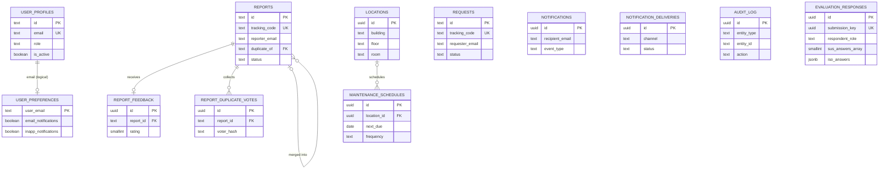

# UNIFIX

UNIFIX is a Vue and Vite campus maintenance reporting application. Supabase provides its production backend (Postgres, authentication, and row-level authorization).

## Development

```bash
pnpm install
pnpm dev
```

## Supabase setup

Supabase is prepared as the database layer for reports, requests, and login events.

1. Create a Supabase project.
2. Copy `.env.example` to `.env.local`.
3. Set `VITE_SUPABASE_URL` and `VITE_SUPABASE_ANON_KEY` from the project API settings.
4. Run the complete `supabase/schema.sql` script in the Supabase SQL Editor for a new project. For an existing project, apply the additive scripts in `supabase/migrations/` in filename order. Both paths request a PostgREST schema-cache reload after the database objects are installed.
5. Users can submit registrations from the public **Create account** page. Apply `202610050017_user_registration_approval.sql`; each new Auth account then gets a pending, inactive Employee profile, which an Admin must approve and assign a role to before sign-in is enabled.
6. Deploy the public and notification Edge Functions after setting the CAPTCHA, allowed-origin, and notification values below.

### Phase 1 capabilities

- Report and request images are compressed in the browser and stored in the private `report-photos` bucket (up to three JPG/PNG/WebP images per work item, at most 5 MB each).
- Every report and request receives a database-generated tracking code. The public tracking page reveals only milestone status, a generic assigned team label, and the last update time.
- Administrators can review and assign reports and requests, and verify completed work.
- A reporter can submit one 1–5 rating and optional comment after a report is completed. Administrators and assistants can see report average ratings.

### Public report CAPTCHA

The public report form uses Cloudflare Turnstile. Add the widget's **site key** to
`VITE_TURNSTILE_SITE_KEY` and configure the allowed hostname in the Turnstile dashboard.
Then deploy the included Edge Function and store the Turnstile **secret key** only
in Supabase (never in `.env.local` or the frontend):

```bash
supabase secrets set TURNSTILE_SECRET_KEY=your-turnstile-secret-key
supabase secrets set TURNSTILE_ALLOWED_HOSTNAME=unifix.nvsu.edu.ph
supabase secrets set PUBLIC_APP_ORIGIN=https://your-production-hostname
supabase functions deploy submit-public-report
supabase functions deploy track-report
```

The function verifies each token with Cloudflare before inserting the anonymous
report with its service role. `supabase/config.toml` deliberately allows this
function to be called without a user JWT; Turnstile verification is the gate.

### Account registration and role review

Applicants may request Employee, Assistant, or Personnel during registration.
The request is stored separately from the account's effective role; new profiles
remain inactive and pending until an Admin confirms or changes the role and
approves the application. Public registration cannot request the Admin role.
Apply migration `202610060007_requested_registration_role.sql` to existing
projects before enabling role selection.

### Phase 2 notifications and workflow

- Reports and requests now move from **In progress** to **For verification** when personnel submit completed work. Admins or assistants can verify and close the item, or reject it with a reason to return it for rework. The submitter can reopen a closed item within seven days using its tracking code; authenticated callers can also use an owner-checked reopen RPC.
- In-app notification feeds are private to each signed-in email and update through Supabase Realtime. Notification settings separately control in-app, email, and SMS delivery.
- Notification feeds are private to each signed-in email and update through Supabase Realtime. Notification settings separately control in-app, email, and SMS delivery.
- Email uses Resend. SMS uses the optional Semaphore adapter and stays disabled in the UI unless `VITE_SMS_NOTIFICATIONS_ENABLED=true` is set in the deployed frontend and the matching provider credentials are configured in Supabase.

Apply `supabase/migrations/202610050002_phase2_notifications_audit_verification.sql` to an existing project, or use the updated `supabase/schema.sql` for a fresh project. Set the server-only provider credentials (never put these in a `VITE_` variable):

```bash
supabase secrets set NOTIFICATION_WEBHOOK_SECRET=replace-with-a-long-random-secret
supabase secrets set RESEND_API_KEY=replace-with-resend-key
supabase secrets set NOTIFICATION_FROM_EMAIL="UNIFIX <notifications@example.edu>"
# Optional SMS provider:
supabase secrets set SEMAPHORE_API_KEY=replace-with-semaphore-key
supabase secrets set SEMAPHORE_SENDER_NAME=UNIFIX
supabase functions deploy deliver-notification
```

In **Database → Webhooks**, create an `INSERT` webhook on `public.notification_deliveries` targeting
`https://<project-ref>.supabase.co/functions/v1/deliver-notification`. Add the
`x-notification-secret` HTTP header with the same secret stored as
`NOTIFICATION_WEBHOOK_SECRET`. The Edge Function authenticates this shared-secret
header; its JWT verification is disabled in `supabase/config.toml`.

The notification delivery function supports retrying failed deliveries through
its authenticated `retry-failed` action. Preventive-maintenance work generation
is scheduled separately as described below.

The schema migration backfills requester contact emails where a profile can be
matched. Public report status emails are optional and sent only when the reporter
provides an email address. Public tracking remains limited to milestone dates,
the generic maintenance-team label, and the last update; it never returns names,
contact details, or internal remarks.

### Phase 3 analytics and smart operations

- Admin and Assistant dashboards include date/category-filtered operational KPIs, workload and issue charts, CSV export, and a print-ready PDF summary. Production aggregates are calculated by the `get_unifix_analytics` database function; demo mode calculates the same metrics from local demo records.
- Report submission checks open reports with the same category and location and a similar title. The reporter can add a vote/note to an existing report or continue as a distinct issue. Public matching returns only a small set of matching issue details, and search/vote RPCs are rate-limited. Administrators can merge eligible reports; merged items inherit later status changes from the primary report.
- Administrators manage building/floor/room locations. Active locations populate report and request forms; printable QR sheets link to `/report?location=<id>` and pre-fill the matching report location.
- Service requests include a formatted job-order print view with control number, requester/office, service details, signature blocks, and completion/acceptance section. The **Download PDF** action opens the browser's print dialog; select **Save as PDF**.
- Administrators can create/edit and pause preventive-maintenance schedules. Due schedules generate tagged work orders and advance their next-due date. The Admin panel's **Generate due work orders** action runs due schedules immediately.

Apply `supabase/migrations/202610050003_phase3_analytics_duplicates_locations_maintenance.sql` to an existing project, or use the updated `supabase/schema.sql` for a fresh project. To run preventive schedules automatically, enable `pg_cron` in the Supabase Dashboard, then schedule the database function in the SQL Editor:

```sql
select cron.schedule(
  'unifix-preventive-maintenance',
  '0 2 * * *',
  $$select public.generate_due_maintenance_work_orders();$$
);
```

The daily job creates at most one work order per schedule per due date and advances overdue schedules to their next future occurrence. The Admin panel also provides a manual generation action. Keep the QR route available through the deployment's SPA fallback so `/report?location=<id>` serves the Vue application.

Production builds refuse to start if demo mode is enabled or required Supabase
and Turnstile configuration is missing. In local development, the app uses demo
data whenever `VITE_DEMO_MODE=true`, even if local Supabase values are present.
Never commit `.env.local`.

For local-only demo mode without Supabase, explicitly set `VITE_DEMO_MODE=true`. Do not enable this in a deployed environment; the demo data is intentionally client-side and is not an authentication boundary.

### Backend behavior

The schema creates reports, requests, login events, user profiles, and persisted user preferences. It also enables Row Level Security:

- authenticated reporters can create and view their own reports/requests;
- administrators manage all records and user profiles;
- assistants can adjust risk and review submissions;
- assigned personnel can progress only their own work orders; and
- users can edit only their own contact details and notification preferences.

The Phase 1 migration creates the private `report-photos` bucket and its storage policies, report feedback, tracking-code triggers, and a private rate-limit store used by `track-report`. For an existing project, apply all migrations in filename order, including `202610050016_remove_sla_and_audit_features.sql`.

Create the matching Supabase Auth users before signing in. Profile records use the same email address as the Auth user; roles are never accepted from the browser in production.

## Security note

The database policies require Supabase Auth and match authenticated email addresses to `user_profiles`. Roles are loaded from the database after sign-in; the role picker is shown only in explicitly enabled local demo mode. The open demo policies have been removed from the schema.

### Phase 4 quality, security, and evaluation

- The app is installable as a PWA, caches its application shell after the first online visit, and shows an offline fallback. Public report drafts (including compressed photo files) can be saved in IndexedDB on the device. Drafts are restored on reconnect but are **not silently submitted**: users must review the content, reconnect, and complete Turnstile verification before sending.
- Anonymous SUS and ISO/IEC 25010 evaluation is available from the public home page and signed-in navigation. The survey stores only ratings and a respondent-selected role. No name, email, or account identifier is saved. Public writes go through a size-limited, origin-checked Edge Function with database-backed rate limiting; the Admin results page returns aggregates only.
- Personnel report reads are restricted to reports assigned to them or reports they personally submitted. New evaluation responses have RLS enabled and cannot be read directly by any client role.
- Vitest covers report/request verification transitions. The pgTAP RLS suite is in `supabase/tests/phase4_rls.test.sql`. Run `pnpm test` for unit tests and `pnpm test:rls` against a local/staging Supabase instance.
- `pnpm security:check` scans the built frontend bundle for a service-role environment reference or JWT. `vercel.json`, `public/_headers`, and `public/_redirects` configure deployment security headers and SPA routing.
- Deployment steps are in [DEPLOYMENT.md](DEPLOYMENT.md). Role-specific instructions are indexed in [USER_MANUAL.md](USER_MANUAL.md), and release notes are in [CHANGELOG.md](CHANGELOG.md).

### Local verification

```bash
pnpm install
pnpm dev
pnpm test
pnpm build
pnpm security:check
```

The security bundle scan requires a completed production build. The RLS test
requires the Supabase CLI and a disposable local or staging database. Apply
`supabase/migrations/202610050004_phase4_evaluation_security.sql` after the
Phase 1–3 migrations, or use the complete `supabase/schema.sql` for a new
project. Deploy `swift-worker` as described in [DEPLOYMENT.md](DEPLOYMENT.md).
Apply all numbered migrations through `202610050010` in sequence on an existing
project.

### Frontend environment variables

Copy `.env.example` to `.env.local` for development. Only these non-secret
frontend settings are read by Vite:

| Variable | Description |
| --- | --- |
| `VITE_SUPABASE_URL` | Public Supabase project URL |
| `VITE_SUPABASE_ANON_KEY` | Public/anon Supabase key; data authorization is enforced by RLS |
| `VITE_TURNSTILE_SITE_KEY` | Public Turnstile widget key |
| `VITE_ALLOWED_EMAIL_DOMAINS` | Comma-separated allowed domains displayed by the registration form; the database setting remains the enforcement source |
| `VITE_ERROR_REPORT_URL` | Optional HTTPS client error-ingestion endpoint; public URL, no credentials |
| `VITE_SMS_NOTIFICATIONS_ENABLED` | Enables the SMS preference only when its backend provider is configured |
| `VITE_DEMO_MODE` | Enables local demo behavior; production startup rejects `true` |

Supabase service-role, Resend, Semaphore, Turnstile secret, and notification
webhook values are backend secrets. Set them with `supabase secrets set` and
never place them in a `VITE_` variable or client environment file. Optional
provider setup is covered in the Phase 1/2 sections and deployment guide.

### Role permission matrix

| Capability | Public | Employee | Assistant | Personnel | Admin |
| --- | --- | --- | --- | --- | --- |
| Submit public report and track by code | Yes | Yes | Yes | Yes | Yes |
| Submit/read service requests | No sign-in; public report flow | Own requests | Review requests | Assigned requests only | All |
| View reports | Tracking milestones only | Own submissions | All reports | Assigned reports and own submissions | All |
| Assign personnel / manage users and roles | No | No | No | No | Yes |
| Update assigned work progress | No | No | No | Assigned work only | Yes |
| Verify completed work | No | No | Yes | No | Yes |
| Configure locations and maintenance schedules | No | No | No | No | Yes |
| View analytics | No | No | Analytics | No | Yes |
| View evaluation aggregates | No | No | No | No | Yes |
| Submit optional anonymous evaluation | Yes | Yes | Yes | Yes | Yes |

The database also recognizes a `Student` profile role. It can submit its own
report and optional feedback but has no additional administration privileges.
Public reports go through the restricted tracking and submission functions;
anonymous clients do not get direct report-row access.

### Database ERD



The notifications/delivery records use recipient and entity identifiers rather
than a direct database foreign key. `user_preferences.user_email` is also an
email-keyed logical association rather than an enforced foreign key.

Run `supabase/seed-demo.sql` **only in a disposable demo project** to create
representative open, assigned, completed, and rated work records for
the analytics dashboard. It refuses to run unless the same SQL session first
executes `set unifix.allow_demo_seed = 'true';`. Use this explicit override only
on a disposable project; never run the seed against production.
